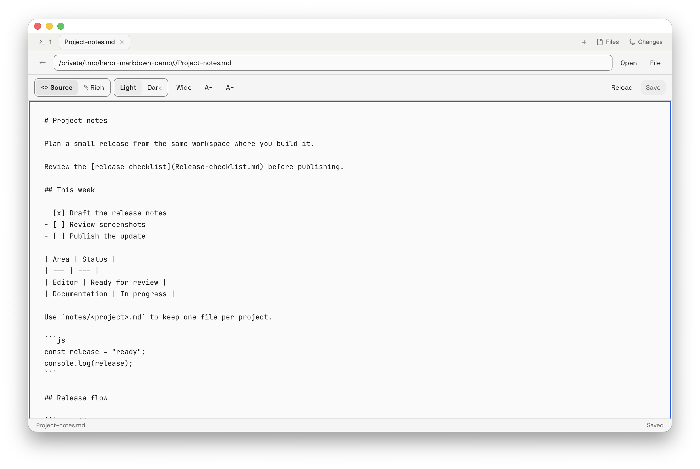
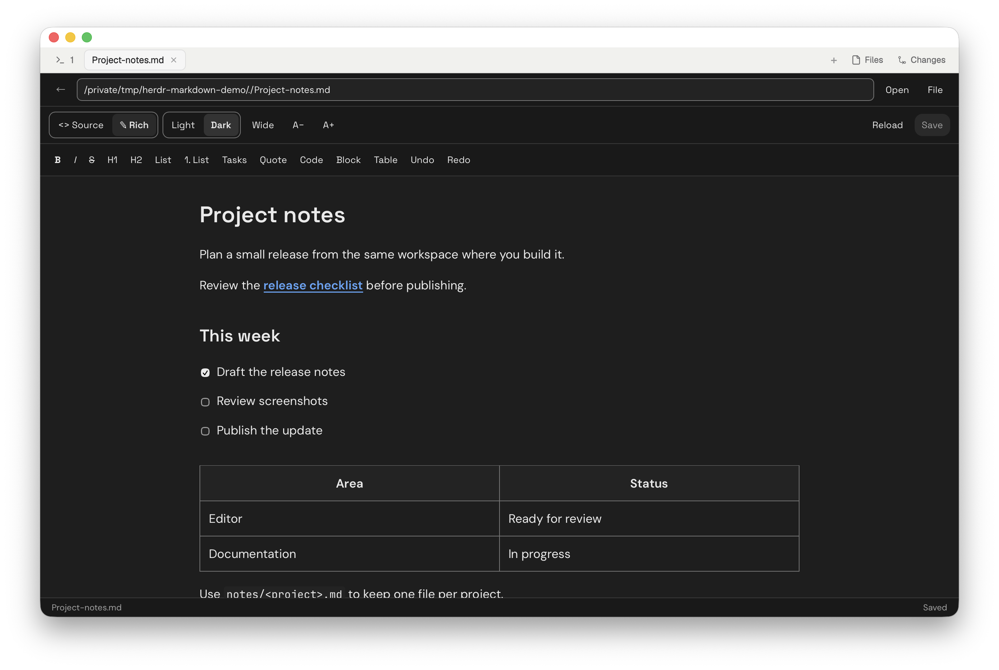
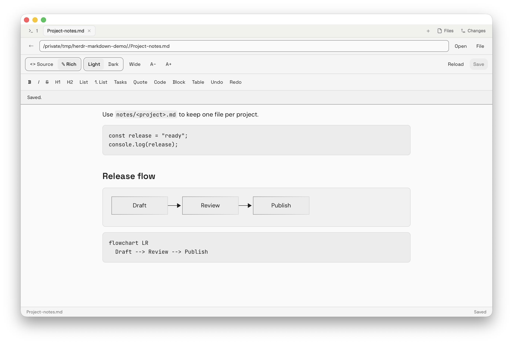

# Herdr Markdown

Open a Markdown file from a Herdr terminal and edit it in a tab. Use **Rich** to edit the formatted document directly, or switch to **Source** to edit the Markdown.

> **Requires a patched macOS build of Herdr.** The bundled [native host patch](native/README.md) provides the WebView APIs used by the editor. Install the mod alongside that build to use Rich editing.

## Edit and save in Rich

Type directly into a formatted paragraph and save the file.

https://github.com/user-attachments/assets/1adb457c-a0cb-4421-9536-b59e08ce3e83

## More demos

| Video | What you’ll see |
| --- | --- |
| [Open from a terminal](https://cdn.jsdelivr.net/gh/dotoridot/herdr-markdown@b7609e257ad84d8bc6b0853a7cb20a1fef6a299d/media/open-from-terminal.mp4) | Cmd-click a local Markdown path to open it in a tab named after the file. |
| [Switch views and themes](https://cdn.jsdelivr.net/gh/dotoridot/herdr-markdown@b7609e257ad84d8bc6b0853a7cb20a1fef6a299d/media/formatting.mp4) | Toggle Light and Dark, switch between Source and Rich, and see a rendered Mermaid diagram. |
| [Follow links and switch tabs](https://cdn.jsdelivr.net/gh/dotoridot/herdr-markdown@b7609e257ad84d8bc6b0853a7cb20a1fef6a299d/media/navigation.mp4) | Follow a local document link, use Back, and switch between the document and terminal tabs. |

## Screenshots

| Source view | Dark theme |
| --- | --- |
|  |  |



## What you can do

| Workflow | In Herdr Markdown |
| --- | --- |
| Open and edit | Cmd-click a local Markdown path in a terminal to open a tab named after the file. Edit text directly in Rich or switch to Source. |
| Format | Use the Rich toolbar for headings, emphasis, lists, quotes, code and tables. Tick task checkboxes inline and preview Mermaid code and local images. |
| Read | Choose Light or Dark, adjust the text size, and switch between a reading column and a wide layout. Links are blue and underlined. Hold Cmd over a link to see a hand pointer, then click to follow it. |
| Switch and return | Keep the scroll position and draft when leaving a Herdr tab. Use Back to return after following a link to another local Markdown file. |
| Save | Click Save or press Cmd+S. If the file changed on disk, the editor keeps your draft and reports the conflict. Reload asks before discarding unsaved edits. |

YAML frontmatter and raw HTML appear as inert source fragments in Rich. Use Source to edit them. Opening a file or switching views preserves the original Markdown. Editing in Rich can normalize whitespace, delimiters, and line endings when the draft is serialized.

The editor bundles DM Sans, Space Grotesk, Noto Sans KR and JetBrains Mono. Existing non-printing control characters in Rich prose appear as labels such as `[U+001C]`. The bytes are preserved in the draft. A file containing a null byte is treated as binary.

## Install

The native host patch and its matching base revision are in [native/](native/README.md). Build and test the patched application separately before replacing your usual Herdr app. Keep your existing app and config available for rollback.

Copy `mods/rich-document/` into your Herdr app home's `mods/` directory. The usual home is `~/.config/herdr-app`. Preserve any existing mod under a different name before replacing it.

Open a document through the patched app's local terminal Cmd-click handler, or explicitly create a mod tab:

```sh
herdr-app do tab.new '{"name":"notes.md","mod":"rich-document","props":{"file":"/absolute/path/notes.md"}}'
```

Cmd-click handles existing local `.md`, `.markdown`, `.mdown`, and `.mkd` files. Remote terminal links retain Herdr's system opener behavior. Manually opened remote document props use the read-only native preview.

The editing limit is 1 MiB of UTF-8 text per file. Local image previews are limited to 16 MiB. The legacy read-only preview targets earlier patched builds; compatibility with stock Herdr releases is not verified. Its optional Mermaid renderer needs Node, Python 3, local Chrome/Chromium, and `npm ci` in `mods/rich-document/renderer/`.

## Develop

Use a separate app home and Core session for native testing so your live terminals remain untouched.

```sh
npm ci
npm run build
npm test
herdr-app check /absolute/path/to/mods/rich-document
```

The browser tests exercise the editor and its message contract. They do not prove native WebKit keyboard routing, IME, tab visibility, or installed app behavior. Native validation is recorded separately in `VALIDATION.md`.

The WebView page loads only bundled assets under its assigned root. It has no network or direct file access. File reads, compare-and-swap writes, local image staging, links, and Finder actions go through the owning Herdr mod. The read-only fallback can run Python and Node subprocesses for images and diagrams. Installing the mod grants it the normal capabilities of trusted Herdr mod code.

## Sharing

Herdr Mods discovers repositories through the `herdr-mod` topic, `RECIPE.md`, and `preview.png`. Repository publication and catalog indexing are separate: indexing is controlled by Herdr's catalog. See `VALIDATION.md` for release status.

## Licenses

Project source is Apache-2.0. Font licenses are under `mods/rich-document/editor/fonts/`. Bundled JavaScript notices accompany the editor bundle and Mermaid renderer. See `NOTICE` for upstream projects.
