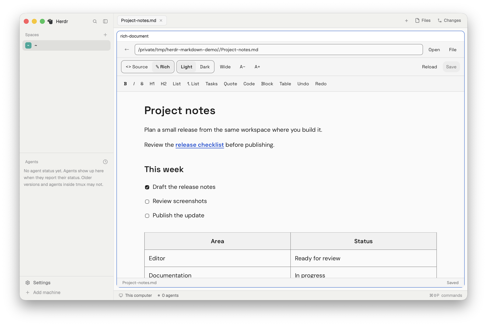

# Markdown

A Markdown tab with a source editor and a formatted document you can edit directly. It offers local fonts, neutral Light and Dark themes, safe explicit saving, and retained reading positions.

## What you see

The top row contains a previous-document button, an editable absolute file path, Open, and File. Below it are Source / Rich controls, Light / Dark controls, width and text-size controls, Reload, and Save. Rich adds a wrapping formatting toolbar. The document occupies the remaining height; a small footer shows its name and save status.

The default paper is `#fafafa` with `#171717` text. Dark paper is `#181818` with `#ebebeb` text. Controls use neutral surfaces; focus uses blue, and errors use red with a written message. Selection uses a translucent fill so glyphs stay visible. Body text starts at 17px, with a reading column no wider than 900px including padding. Wide expands it to 1800px. At narrow widths the toolbars wrap and the document has 16px side padding.

Use the bundled DM Sans / Noto Sans KR fonts for body text, Space Grotesk / Noto Sans KR for headings and controls, and JetBrains Mono for code.

## How it behaves

Source edits Markdown. Rich is an actual contenteditable Tiptap document, including paragraphs, headings, lists, task lists, tables, inline code, and code blocks. The two views share one draft. View changes alone preserve the original source byte content. YAML frontmatter and raw HTML remain inert, preserved fragments that are editable in Source.

Save writes only when the file still matches the original snapshot. A conflict preserves the draft. Reload confirms before discarding a draft. File and confirmation popups close by their Close/Cancel controls, Escape, and outside clicks. Light / Dark, text size, and width are saved under Herdr's existing `rich-document.reading` preference key.

The host keeps the same WebView DOM when changing Herdr tabs. Scroll and selection stay in that page. Document-link history also keeps per-file draft, scroll, and selection snapshots. Local draft recovery is separate from file saving.

File offers Reveal in Finder, Copy path, and Copy relative path. Cmd/Ctrl-click a document hyperlink to follow it without interrupting normal text editing. Mermaid renders a local preview above its editable code. Local images use a cache while retaining their original Markdown link when saved. Other programs' local file changes are watched and never overwrite a dirty draft automatically.

## Built from

Install `mods/rich-document` as a pane mod with props `{file, root?, on?}`. `main.js` owns the bridge, file I/O, watchers, preferences, draft recovery, and local image staging. Its local WebView page is `editor/index.html`; `src/editor.js` builds the bundled `editor/editor.js`. Tiptap and Mermaid are bundled, and CSS references local font assets.

The matching native host patch exposes `WebViewState.new({asset_root, entry})`, `on("message", ...)`, `post_message(string)`, `release()`, and `WebView.new(state)`. The page sends JSON through `window.ipc.postMessage` and receives JSON strings through the browser `message` event. It sends `ready` before the mod sends document data. The native asset protocol is confined to the assigned asset root. The app routes existing local terminal Markdown links to `tab.new` with this mod.

The mod uses Herdr's `readTextFile`, `writeTextFile` with the expected contents, `watchFolder`, `shared`, `setShared`, clipboard helpers, and `exec`. Python stages local image files. The legacy preview optionally uses Node and local Chrome for Mermaid.

## Watch out

The current full editor needs the included macOS native host extension. Copying files into a stock Herdr installation provides a read-only fallback, not WYSIWYG editing. The GPUI pre backend places native WebViews above GPUI content; the host temporarily hides the retained page while a non-toast GPUI overlay is open. Native WebViews can be missing from GPUI frame screenshots, so validate them with an OS window capture.

Keep script inputs separate from source code: `post_message` serializes strings through JSON. Keep arbitrary document HTML inert and network access disabled. Asset files stay inside the granted root. Document text is limited to 1 MiB UTF-8, and local image previews to 16 MiB.

## Done when

- Source and Rich edits both produce the expected saved Markdown through the real file-writing API.
- A concurrent external edit rejects Save while preserving the user's draft.
- Switching Herdr tabs preserves scroll, caret, and unsaved text.
- Korean IME, selection, copy, undo, and native keyboard shortcuts work in the actual WebView.
- Inline code displays `sessions/<session ID>.md` without converting it to literal entity notation, and literal `&lt;` in source code stays literal.
- Light and Dark load local fonts and remain usable at 320px and 200% zoom.
- File menus and confirmations close by button, Escape, and outside clicks.
- Tests and `herdr-app check` pass, and the installed app/mod files match the reviewed release artifacts.
